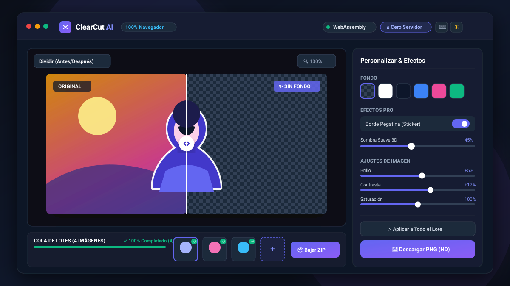
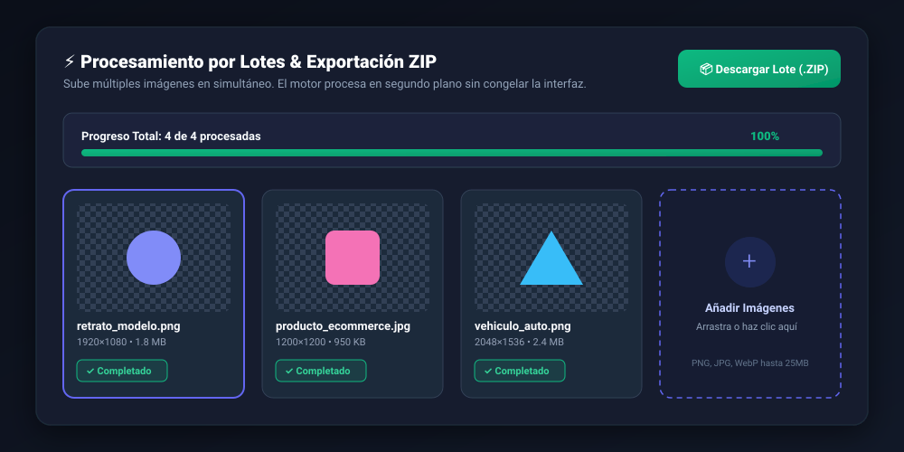
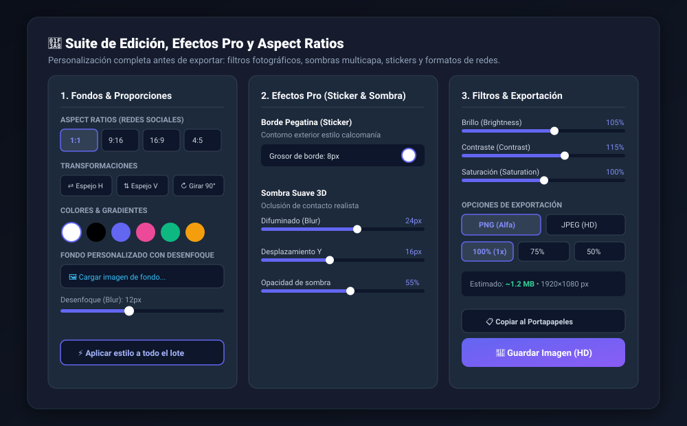
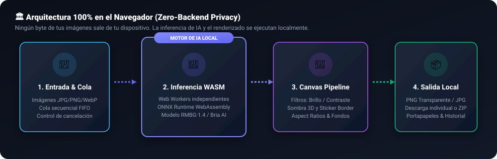

<div align="center">

# ✂️ ClearCut AI

### Eliminación Inteligente de Fondos por Lotes con WebAssembly e IA en el Navegador

**100% Privado • Sin Servidores • Sin Claves de API • Aceleración Local con ONNX Runtime**

[](https://pages.github.com/)
[](https://webassembly.org/)
[](./LICENSE)
[](https://vitejs.dev/)
[](https://www.typescriptlang.org/)
[](https://github.com/)

<br />

<!-- Hero Preview Screenshot -->
<p align="center">
  
</p>

</div>

---

## 📑 Tabla de Contenidos

1. [Visión General](#-visión-general)
2. [Capturas de Pantalla](#-capturas-de-pantalla)
3. [Características Principales](#-características-principales)
4. [Arquitectura y Privacidad](#-arquitectura-y-privacidad)
5. [Atajos de Teclado](#-atajos-de-teclado)
6. [Instalación y Ejecución Local](#-instalación-y-ejecución-local)
7. [Despliegue en GitHub Pages](#-despliegue-en-github-pages)
8. [Estructura del Proyecto](#-estructura-del-proyecto)
9. [Preguntas Frecuentes (FAQ)](#-preguntas-frecuentes-faq)
10. [Licencia](#-licencia)

---

## 🌟 Visión General

**ClearCut AI** es una aplicación web moderna, ultrarrápida y de código abierto diseñada para eliminar el fondo de una o docenas de imágenes en lote de forma automática, directamente en el navegador del usuario utilizando **WebAssembly (WASM)** y redes neuronales profundas (ONNX Runtime).

A diferencia de otros servicios convencionales que suben tus fotos a servidores externos o cobran suscripciones por procesamiento en la nube:

- 🛡️ **Tus fotos jamás salen de tu equipo:** Cero almacenamiento remoto, cero backend, cero telemetría invasiva.
- 💸 **Sin costes de API ni límites:** Ejecuta tantas fotos como desees sin gastar cuotas ni pagar por token.
- ⚡ **Multi-procesamiento en lote:** Sube varias imágenes simultáneamente, supervisa la cola de procesamiento y descarga un archivo `.ZIP` comprimido con un solo clic.
- 🎨 **Suite de retoque y efectos de estudio:** Fondos de color sólido, gradientes, desenfoque de fondo personalizado, contorno estilo pegatina (*sticker*), sombra suave 3D, filtros de luz (brillo, contraste, saturación) y proporciones predefinidas para Instagram, TikTok, Reels y E-Commerce.

---

## 📸 Capturas de Pantalla

### 1. Vista Principal con Slider Antes / Después
Permite inspeccionar con precisión milimétrica los bordes recortados mediante un divisor interactivo arrastrable, acompañado de zoom óptico y selector de fondo transparente cuadriculado.

<div align="center">
  
</div>

<br />

### 2. Cola de Procesamiento por Lotes y Descarga Masiva en ZIP
Procesa múltiples fotos en segundo plano con control de cola secuencial, estado en tiempo real, barras de progreso acumuladas y empaquetado directo en `.zip` vía JSZip.

<div align="center">
  
</div>

<br />

### 3. Suite de Edición, Efectos Pro y Formatos de Redes Sociales
Control total sobre el resultado final: ajusta grosor de pegatinas, desenfoque de sombras 3D, proporciones de aspecto (1:1, 9:16, 16:9, 4:5), espejado, rotación y filtros de luminancia.

<div align="center">
  
</div>

---

## 🚀 Características Principales

### 🧠 Inteligencia Artificial 100% en el Navegador
- Impulsado por el modelo de segmentación de alta precisión **RMBG-1.4 (Bria AI)** y **ONNX Runtime Web**.
- Los pesos del modelo se cargan en caché local del navegador tras la primera ejecución, permitiendo procesar incluso sin conexión a internet.
- Aceleración por WebAssembly con hilos de **Web Workers** para mantener la interfaz a 60 FPS sin congelamientos.

### 📦 Procesamiento por Lotes y Descarga ZIP
- Añade múltiples imágenes arrastrando o seleccionando archivos (PNG, JPG, WebP).
- Barra de progreso general acumulada y estados individuales (*En cola*, *Procesando*, *Completado*).
- Posibilidad de cancelar el lote en cualquier momento.
- Botón **"Descargar Lote (.ZIP)"** que comprime todas las imágenes recortadas en el cliente en segundos.

### 🎨 Fondos Personalizados
- **Transparente puro:** Ideal para diseño gráfico, catálogos y logos (patrón ajedrezado).
- **Colores Sólidos:** Paleta rápida de 8 colores curados + selector libre RGB / HEX.
- **Gradientes Profesionales:** Degradados modernos suaves para productos y retratos.
- **Fondo de Imagen con Desenfoque:** Carga cualquier fotografía de fondo y ajusta el slider de desenfoque (*Gaussian blur*) para lograr un efecto de profundidad de campo cinematográfico.

### ✨ Efectos Pro de Estudio
- **Borde de Pegatina (*Sticker Outline*):** Genera un contorno blanco o de color alrededor de la figura recortada, perfecto para miniaturas de YouTube, stickers de mensajería y marketing digital.
- **Sombra Suave 3D (*Drop Shadow*):** Simula oclusión ambiental realista con control de radio de difuminado (*blur*), desplazamiento vertical (Y), opacidad y tinte de color.

### 🎛️ Filtros Fotográficos en Tiempo Real
- **Brillo (-100% a +100%):** Corrige subexposición o sobreexposición.
- **Contraste (-100% a +100%):** Acentúa la profundidad y rango dinámico.
- **Saturación (0% a 200%):** Desde escala de grises artística hasta colores vívidos e intensos.

### 📐 Redes Sociales y Transformaciones
- **Formatos de Lienzo Predefinidos:**
  - `Original`: Mantiene las dimensiones exactas de la foto fuente.
  - `1:1 Cuadrado`: Perfecto para publicaciones de Instagram y fotos de perfil.
  - `9:16 Vertical`: Diseñado para Instagram Reels, TikTok, YouTube Shorts y Stories.
  - `16:9 Panorámico`: Optimizado para miniaturas de YouTube y banners web.
  - `4:5 Retrato`: El formato de mayor visibilidad en el feed móvil de Instagram.
- **Herramientas de Transformación:**
  - ⇄ Invertir Horizontal (Efecto espejo).
  - ⇅ Invertir Vertical.
  - ↻ Rotar en 90 grados.

### ⚡ Propagación por Lote
- Con el botón **"Aplicar a todo el lote"**, transfiere al instante el fondo, sombras, filtros y bordes configurados en la foto activa a todas las demás imágenes de la cola de trabajo.

### 💾 Almacenamiento Local (Local History)
- Guarda automáticamente en `localStorage` las miniaturas de las últimas 5 imágenes procesadas exitosamente. Si cierras o recargas la pestaña, puedes recuperarlas al instante con un solo clic.

### 🌓 Interfaz Profesional & Accesibilidad
- Selector de tema **Modo Oscuro** (Dark) y **Modo Claro** (Light).
- Diálogo flotante de atajos de teclado accesible con la tecla `?`.
- Estimación en tiempo real del tamaño de archivo y resolución antes de descargar.
- Copiado directo al portapapeles con un clic para pegar en Photoshop, Figma, Canva o Slack.

---

## 🏛️ Arquitectura y Privacidad

ClearCut AI fue concebido con el principio fundamental de **Zero-Knowledge Architecture**:

<div align="center">
  
</div>

<br />

| Capa | Tecnología | Función |
| :--- | :--- | :--- |
| **Interfaz & UX** | HTML5, Tailwind CSS, TypeScript | Diseño responsivo, temas, sliders y controles de lienzo |
| **Pipeline Asíncrono** | Web Workers nativos | Ejecuta cálculos intensivos sin interferir con la fluidez del navegador |
| **Inferencia de IA** | WebAssembly (WASM) + ONNX Runtime Web | Ejecución de la red neuronal de segmentación de bordes directamente en CPU/GPU local |
| **Composición Gráfica** | HTML5 Canvas 2D Context | Mezcla de sombras multicapa, sticker outline, filtros CSS y aspect ratios |
| **Empaquetado** | JSZip (JavaScript Client Engine) | Generación binaria y descarga del archivo ZIP sin llamadas a la red |

---

## ⌨️ Atajos de Teclado

| Atajo | Acción |
| :---: | :--- |
| <kbd>Ctrl</kbd> + <kbd>O</kbd> / <kbd>⌘</kbd> + <kbd>O</kbd> | Abrir selector de archivos o añadir a la cola |
| <kbd>Ctrl</kbd> + <kbd>S</kbd> / <kbd>⌘</kbd> + <kbd>S</kbd> | Descargar la imagen actual recortada en HD |
| <kbd>Ctrl</kbd> + <kbd>C</kbd> / <kbd>⌘</kbd> + <kbd>C</kbd> | Copiar la imagen con fondo transparente al portapapeles |
| <kbd>Ctrl</kbd> + <kbd>Z</kbd> / <kbd>⌘</kbd> + <kbd>Z</kbd> | Restablecer todos los ajustes fotográficos y efectos a sus valores por defecto |
| <kbd>←</kbd> / <kbd>→</kbd> | Navegar a la imagen anterior / siguiente en la cola de lotes |
| <kbd>Espacio</kbd> | Alternar entre vista dividida (slider) y vista completa |
| <kbd>D</kbd> | Alternar tema Claro / Oscuro |
| <kbd>?</kbd> | Abrir / cerrar la ventana de ayuda de atajos de teclado |
| <kbd>Esc</kbd> | Cerrar modales abiertos |

---

## 🛠️ Instalación y Ejecución Local

### Prerrequisitos
- [Node.js](https://nodejs.org/) (versión 18 o superior recomendada)
- Un gestor de paquetes como `npm`, `pnpm` o `bun`

### 1. Clonar el repositorio
```bash
git clone https://github.com/TU-USUARIO/clearcut-ai.git
cd clearcut-ai
```

### 2. Instalar dependencias
```bash
npm install
```

### 3. Iniciar el servidor de desarrollo
```bash
npm run dev
```
La aplicación estará disponible inmediatamente en `http://localhost:3000`.

### 4. Compilar para producción
```bash
npm run build
```
Esto genera una carpeta `/dist` optimizada y lista para alojarse en cualquier servidor estático (GitHub Pages, Vercel, Netlify, Cloudflare Pages, S3).

---

## 🚀 Despliegue en GitHub Pages

El proyecto incluye un flujo de trabajo preconfigurado de **GitHub Actions** en `.github/workflows/deploy.yml` para desplegar automáticamente con cada `push` a la rama `main`.

### Pasos para activar en tu repositorio:

1. Sube tu código a GitHub:
   ```bash
   git init
   git add .
   git commit -m "feat: ClearCut AI release inicial"
   git branch -M main
   git remote add origin https://github.com/TU-USUARIO/clearcut-ai.git
   git push -u origin main
   ```

2. En GitHub, ve a la pestaña **Settings** (Configuración) de tu repositorio.
3. En el menú lateral izquierdo, haz clic en **Pages**.
4. En **Build and deployment > Source**, selecciona **GitHub Actions**.
5. ¡Listo! La acción de compilación se ejecutará automáticamente y tu aplicación estará disponible en minutos en:
   ```
   https://TU-USUARIO.github.io/clearcut-ai/
   ```

*(Nota: Gracias a la configuración `base: './'` en `vite.config.ts`, la aplicación funciona perfectamente tanto en la raíz de un dominio como en subdirectorios de repositorios de GitHub Pages).*

---

## 📂 Estructura del Proyecto

```text
clearcut-ai/
├── .github/
│   └── workflows/
│       ├── deploy.yml            # Despliegue automatizado a GitHub Pages
│       └── ci.yml                # Comprobación de tipos y build en PRs
├── docs/
│   └── screenshots/              # Capturas y diagramas vectoriales para el README
│       ├── hero-preview.svg      # Vista general del editor
│       ├── batch-workflow.svg    # Flujo de procesamiento por lotes
│       ├── editor-controls.svg   # Panel de filtros y efectos pro
│       └── architecture.svg      # Diagrama de arquitectura client-side
├── public/                       # Activos estáticos públicos
│   └── screenshots/              # Capturas disponibles para la app compilada
├── index.html                    # Aplicación cliente completa con WebAssembly
├── vite.config.ts                # Configuración de compilación Vite con rutas relativas
├── tsconfig.json                 # Configuración de TypeScript
├── package.json                  # Scripts y dependencias
├── LICENSE                       # Licencia MIT
├── CONTRIBUTING.md               # Guía para colaboradores
└── README.md                     # Documentación principal
```

---

## ❓ Preguntas Frecuentes (FAQ)

<details>
<summary><strong>¿Mis fotos se envían a algún servidor de IA?</strong></summary>
<p>No. En absoluto. Todo el procesamiento de inteligencia artificial ocurre de forma 100% local en tu dispositivo utilizando WebAssembly y modelos ONNX compilados para el navegador. Puedes desconectar tu conexión a internet después de cargar la aplicación y seguirá funcionando con total normalidad.</p>
</details>

<details>
<summary><strong>¿Existe algún límite en la cantidad de fotos que puedo procesar?</strong></summary>
<p>No hay límites artificiales ni límites de uso. Puedes procesar cientos de fotos por lotes. El único factor determinante es la memoria RAM disponible en tu dispositivo.</p>
</details>

<details>
<summary><strong>¿Por qué el primer procesamiento tarda unos segundos más?</strong></summary>
<p>La primera vez que abres la app, el navegador descarga el modelo de segmentación (~30 MB) y lo almacena en la caché de tu navegador. A partir de la segunda imagen, el modelo ya reside en la memoria local y los recortes se completan en una fracción del tiempo.</p>
</details>

<details>
<summary><strong>¿Qué formatos de imagen son compatibles?</strong></summary>
<p>Soporta formatos estándar como PNG, JPEG/JPG, WebP y BMP. Las imágenes resultantes pueden exportarse con canal alfa transparente en PNG o con fondo en JPEG de alta calidad.</p>
</details>

---

## 📄 Licencia

Este proyecto está bajo la licencia **MIT**. Consulta el archivo [LICENSE](./LICENSE) para más detalles.

---

<div align="center">
  <sub>Desarrollado con ❤️ y WebAssembly para una web más rápida, privada y sin servidores.</sub>
</div>
