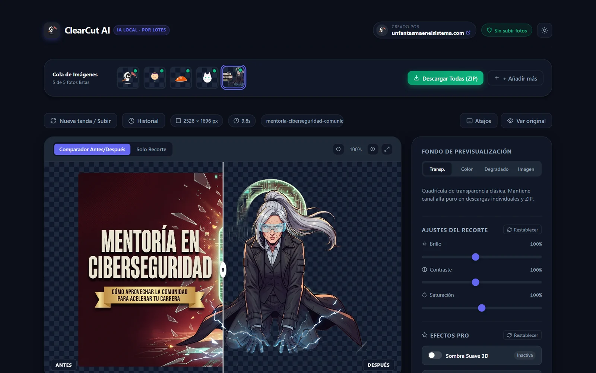
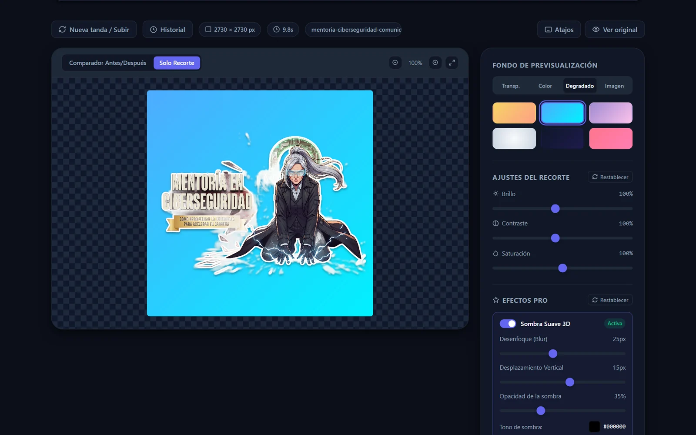
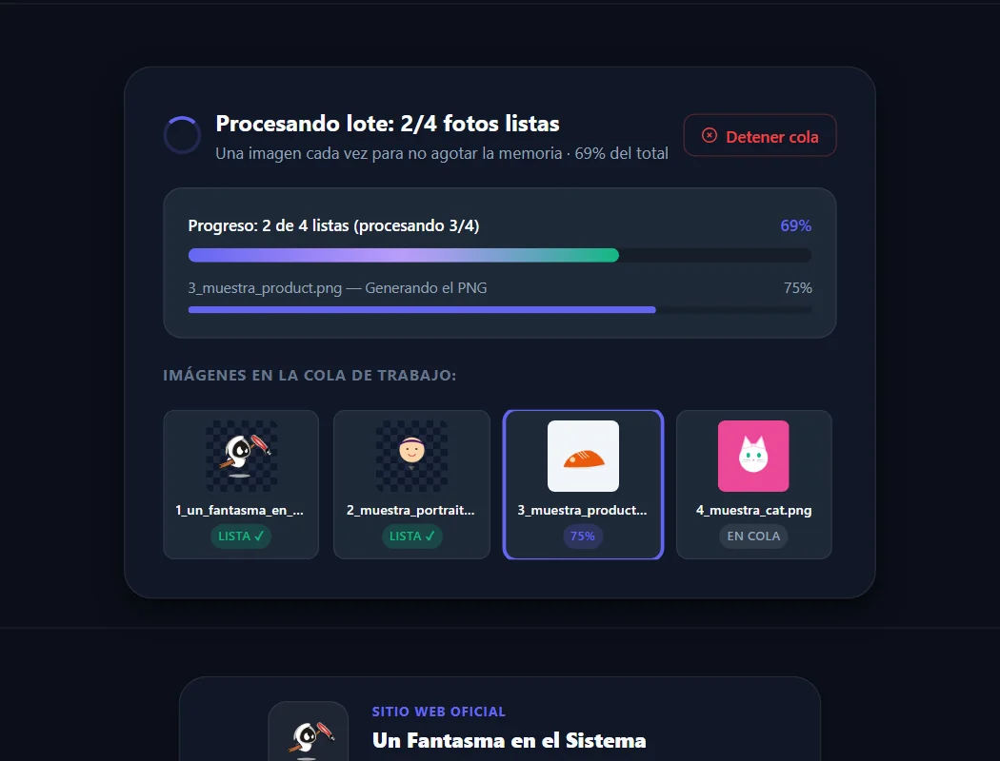
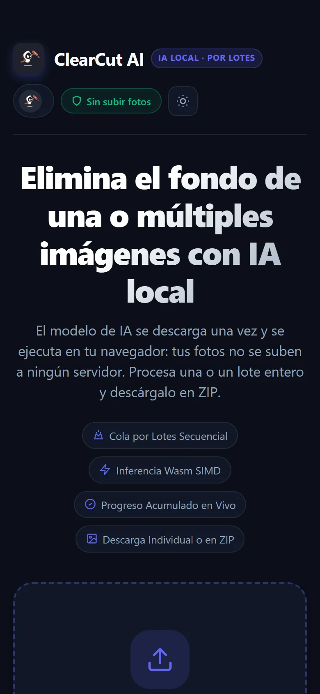

<p align="center">
  <a href="https://www.unfantasmaenelsistema.com"></a>
</p>

<h1 align="center">ClearCut</h1>

<p align="center">
  <b>Quita el fondo de tus imágenes en el navegador, sin subirlas a ningún sitio</b><br>
  Una foto o un lote entero · Fondos, sombra y borde pegatina · Presets para redes · Descarga en PNG, JPG o ZIP
</p>

<p align="center">
  <a href="https://unfantasmaenelsistema.github.io/ClearCut/"><b>▶ Abrir ClearCut</b></a> ·
  <a href="#qué-hace">Qué hace</a> ·
  <a href="#privacidad-qué-sale-de-tu-equipo">Privacidad</a> ·
  <a href="#cómo-funciona">Cómo funciona</a> ·
  <a href="#atajos-de-teclado">Atajos</a> ·
  <a href="https://www.unfantasmaenelsistema.com">unfantasmaenelsistema.com</a> ·
  <a href="#créditos-y-licencia">Licencias</a>
</p>

<p align="center">
  
  
  
  
  
</p>

<p align="center">
  
</p>

Arrastra una o varias imágenes y ClearCut les quita el fondo con una red neuronal (ISNet) que se ejecuta **dentro de tu navegador**. La primera vez descarga el modelo; a partir de ahí las fotos se procesan en tu equipo, una detrás de otra, y puedes retocar el resultado antes de descargarlo.

> [!NOTE]
> El recorte es automático y depende de la foto: con un sujeto claro sobre un fondo distinto suele quedar muy bien; con pelo suelto, cristal, humo o texto encima de la imagen puede dejar restos o comerse bordes. Revisa siempre el resultado con el comparador antes de usarlo.

## Qué hace

- **Cola por lotes**: añade varias fotos (arrastrar, seleccionar o pegar con Ctrl+V) y se procesan de una en una para no agotar la memoria. Puedes seguir añadiendo mientras trabaja y **detener la cola**: termina la imagen en curso y deja el resto pendientes; al añadir más, continúa.
- **Comparador antes/después** con divisor arrastrable, vista solo del recorte, zoom y el botón **Ver original**. El «antes» se gira, voltea y encuadra igual que el resultado, así que siempre comparas lo mismo.
- **Fondo**: transparente, 10 colores o uno libre, 6 degradados o una imagen tuya con desenfoque. Lo que ves en la vista previa es exactamente lo que se descarga.
- **Retoque**: brillo, contraste y saturación del recorte; **sombra** (desenfoque, desplazamiento, opacidad y color) y **borde pegatina** (grosor y color). La sombra incluye el borde.
- **Lienzo**: voltear, girar 90° y presets 1:1, 9:16, 16:9 y 4:5 que dejan margen alrededor del sujeto. **Aplicar a todo el lote** copia los ajustes de la foto activa a las demás.
- **Exportar**: PNG con transparencia o JPG (si el fondo es transparente se exporta en blanco, y te lo avisa), al 100 %, 75 % o 50 %, con estimación de tamaño. **Copiar** al portapapeles o **descargar todo en ZIP** (los nombres repetidos se numeran en vez de pisarse).
- **Historial**: las 5 últimas imágenes, a resolución completa, se guardan en este navegador (IndexedDB) para recuperarlas tras recargar. Se puede vaciar o desactivar.
- **Modelo a elegir**: Rápido (44 MB), Equilibrado (88 MB, por defecto) o Máxima precisión (176 MB), y GPU por WebGPU si el navegador la ofrece, con vuelta automática a la CPU si falla.
- Tema claro/oscuro, funciona en móvil y no deja cerrar la pestaña por descuido si hay recortes sin descargar.

<p align="center">
  
</p>

<p align="center">
  
  &nbsp;
  
</p>

## Privacidad: qué sale de tu equipo

| Qué | Adónde | Cuándo |
| --- | --- | --- |
| Tus imágenes | **A ningún sitio.** Se leen y procesan en la pestaña. | Nunca |
| Modelo ISNet y ONNX Runtime (WebAssembly) | Se descargan de `staticimgly.com`, la CDN de IMG.LY | La primera vez (luego quedan en la caché del navegador) |
| Historial (opcional) | IndexedDB de tu navegador | Al terminar cada imagen, si está activado |
| Preferencias (tema, modelo, GPU) | `localStorage` de tu navegador | Al cambiarlas |

No hay servidor propio, ni analítica, ni cookies. La página publicada lleva una política CSP que solo permite cargar código del propio sitio y conectar con `staticimgly.com`. Puedes comprobarlo en la pestaña *Red* de las herramientas del navegador: al abrir la página no hay ninguna petición externa, y al procesar solo aparecen las del modelo.

## Cómo funciona

1. La imagen se decodifica en el navegador y se reduce a 1024 × 1024 para la red.
2. [ISNet](https://github.com/xuebinqin/DIS) calcula una máscara de primer plano con [ONNX Runtime Web](https://onnxruntime.ai/) (WebAssembly en la CPU o WebGPU). Esa parte la hace la librería [`@imgly/background-removal`](https://github.com/imgly/background-removal-js).
3. La máscara se escala al tamaño original y se aplica como canal alfa: el recorte conserva la **resolución completa** de tu foto.
4. ClearCut compone el resultado en un `<canvas>`: fondo → sombra → borde → recorte, con el giro y el lienzo elegidos.

Tiempos medidos en las pruebas (Chromium, CPU, modelo Equilibrado): una ilustración de 2528 × 1696 px tarda unos **11 s**; la primera imagen añade la descarga del modelo. Con WebGPU, cuando está disponible, la inferencia es bastante más rápida.

## Atajos de teclado

| Atajo | Acción |
| :---: | --- |
| <kbd>Ctrl</kbd>/<kbd>⌘</kbd> + <kbd>S</kbd> o <kbd>D</kbd> | Descargar la foto actual |
| <kbd>Ctrl</kbd>/<kbd>⌘</kbd> + <kbd>C</kbd> | Copiar la foto al portapapeles (si no hay texto seleccionado) |
| <kbd>Ctrl</kbd>/<kbd>⌘</kbd> + <kbd>V</kbd> | Pegar imágenes y añadirlas a la cola |
| <kbd>Espacio</kbd> | Ver original / ver recorte |
| <kbd>H</kbd> · <kbd>V</kbd> · <kbd>R</kbd> | Voltear horizontal · vertical · girar 90° |
| <kbd>+</kbd> · <kbd>-</kbd> · <kbd>0</kbd> | Zoom · restablecer |
| <kbd>←</kbd> · <kbd>→</kbd> | Imagen anterior / siguiente del lote |
| <kbd>?</kbd> | Ver los atajos |

Las letras solo actúan sin Ctrl/⌘, para no robarle al navegador sus atajos (pegar, recargar…).

## Usarlo en local

```bash
git clone https://github.com/unfantasmaenelsistema/ClearCut.git
cd ClearCut
npm ci
npm run dev       # http://localhost:5180
npm test          # pruebas del núcleo (node --test)
npm run build     # genera dist/ para cualquier hosting estático
```

Necesitas Node.js 20 o superior. `src/core.js` contiene la lógica sin DOM (geometría del lienzo, degradados, nombres, atajos) y es lo que cubren las pruebas; `src/app.js` es la interfaz y `src/history-db.js` el historial en IndexedDB. Cada cambio en `main` se prueba y se publica en GitHub Pages con `.github/workflows/pages.yml`.

## Cambios

**v2.0 (2026-10-24)** — revisión completa al pasar a la organización:

- Las muestras de prueba no funcionaban: se generaban como SVG y la app las rechazaba por formato. Ahora se convierten a PNG.
- <kbd>Ctrl</kbd>+<kbd>V</kbd> volteaba la imagen (y <kbd>Ctrl</kbd>+<kbd>R</kbd> la giraba) además de pegar.
- El historial guardaba miniaturas de 320 px y al recuperarlas se descargaban a ese tamaño sin avisar. Ahora guarda los originales en IndexedDB.
- JPG con fondo transparente salía con el fondo negro.
- En el ZIP, las imágenes con el mismo nombre (todo lo pegado se llama `image.png`) se sobrescribían.
- El progreso de la segunda imagen en adelante se apuntaba a la primera (imgly conserva el callback de la primera llamada).
- Si todas fallaban o se detenía la cola sin terminar ninguna, se anunciaba «¡Lote completado!» y quedaba un editor vacío.
- El «antes» del comparador no seguía el giro ni el lienzo; el degradado radial y los lineales no coincidían con su muestra; el desenfoque aparecía con cualquier fondo aunque solo afecta al de imagen.
- Los nombres de archivo se insertaban como HTML en la cola, el historial y los avisos.
- La librería se cargaba de cuatro CDN distintas con versiones mezcladas (una de ellas, 404). Ahora va empaquetada y fijada (`@imgly/background-removal` 1.7.0, ONNX Runtime Web 1.21.0, JSZip 3.10.1) y la página tiene CSP.
- Se quitaron los restos de la plantilla de AI Studio (React vacío, Gemini, Express, TypeScript sin uso), las capturas inventadas en SVG y un README que hablaba de otro modelo (RMBG-1.4), de 30 MB, de funcionar sin conexión y de atajos que no existían.
- Nuevo: elegir modelo, WebGPU con vuelta a CPU, navegación con flechas, aviso al cerrar, accesibilidad de teclado y diseño sin desbordes en móvil.

## Créditos y licencia

Hecho por **[Un Fantasma en el Sistema](https://www.unfantasmaenelsistema.com/)**.

- El código de este repositorio es **[MIT](LICENSE)**.
- La app publicada incluye **[`@imgly/background-removal`](https://github.com/imgly/background-removal-js) de IMG.LY, con licencia [AGPL-3.0](https://www.gnu.org/licenses/agpl-3.0.html)**. Por eso la build que se sirve en GitHub Pages, en su conjunto, se rige por la AGPL-3.0; su código fuente completo es este repositorio, enlazado desde el pie de la propia app.
- Modelo **ISNet** de *Highly Accurate Dichotomous Image Segmentation* (Qin et al., ECCV 2022), Apache-2.0, en la versión que distribuye IMG.LY.
- [ONNX Runtime Web](https://github.com/microsoft/onnxruntime) (MIT) y [JSZip](https://github.com/Stuk/jszip) (MIT o GPL-3.0).

Las capturas usan una ilustración propia de Un Fantasma en el Sistema.
